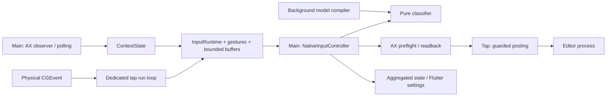

# Аудит производительности Necaramba — 2026-10-15

Область: текущее рабочее дерево, Swift runtime и модель, Flutter lifecycle. Read-only аудит: production, тесты, настройки, формы пользователя и локальные данные модели не изменялись. Только этот отчёт создан. Тесты и сравнение оптимизированной сборки не запускались: оптимизации пока рекомендации, ускорение не заявляется.

## 1. Архитектура сейчас

Разделение Swift Core / Mac adapters / Flutter UI соответствует задаче. Нативный event tap работает в отдельном CFRunLoop, читает кешированный ContextState и передаёт команды на main. Linguistic core независим от AppKit. Модель компилируется на отдельной serial queue и публикуется на main. Flutter создаётся для настроек, shutdown вызывается при закрытии окна; поток клавиш не передаётся через channel. Переписывать интерфейс на AppKit ради скорости клавиш не требуется.

Основной риск отзывчивости — последовательная работа main thread: revalidation фокуса, несколько AX IPC, классификация и синхронное ожидание readback. При задержках браузера здесь стоят следующие команды и уведомления фокуса. Отдельно крупные Swift структуры модели увеличивают footprint; новая открытая модель пока не подключена и не является причиной текущих задержек.

Это локальное single-process приложение с внешними macOS API (AX, TIS, CGEvent) и локальным store; сетевой backend не входит в цикл ввода. Масштабировать нужно частоту ввода, размер словаря и длину редактируемого поля, а не число серверных запросов. Требования macOS 12+, arm64/x86_64, безопасная смена фокуса и сохранение введённого текста ограничивают выбор оптимизаций.

## 2. Поток данных

## 3. Проверенные факты и измерения

Снимок работающей локальной Release-сборки: PID 48297, ARM64, macOS 27.0.1, 15 октября около 12:54 MSK. `vmmap -summary 48297`: **physical footprint 205.1 MiB, peak 348.0 MiB**. Это весь процесс после примерно часа работы, с неизвестной историей открытия UI; не доказательство утечки и не размер одной модели. Отдельный `ps` показал RSS 12,944 KiB / CPU 0.2%; RSS существенно ниже footprint из-за выгруженной/сжатой памяти и не годится как единственная метрика. `vmmap` показывает около 1.15 млн malloc allocations, однако по summary нельзя приписать их конкретному компоненту.

В redacted unified log за последние 15 минут найдены две записи `context.refresh.slowMilliseconds`: **125 и 118 мс**; одна запись `tap.batch.elapsedMicroseconds`: **1102 мкс**. Это отдельные наблюдения, а не p95 или одинаковые по условиям операции. Они подтверждают наличие длинных AX refresh и показывают, что хотя бы одна отправка была короткой. Не доказывают долю AX во всех задержках.

Открытый словарь: 1,497,942 формы, JSON 36,456,028 байт. Отчёт `open-model.md` фиксирует debug CLI peak 495,976,448 байт и 11.46 с. Это декодирование плюс несколько evaluation engines, **не steady-state памяти приложения** и не Release benchmark. Активная локальная модель другая; её содержимое для аудита не читалось.

## 4. Findings

| № | Область | Приоритет | Вывод |
|---|---|---|---|
| 1 | AX / main | High | Синхронный readback и refresh блокируют обработчик команд; измерены refresh 118–125 мс |
| 2 | Контекст / полнота ввода | High | Во время reconcileFocus кеш скрыт; событие в этот интервал сбрасывает захват |
| 3 | Диагностика | High | Есть duration отправки, но нет сквозного разложения задержки; notice на каждом AX stage |
| 4 | Таймеры / энергия | Medium | Постоянный tap timer 50 Гц; recovery timer 4 Гц даже при исправном observer |
| 5 | Модель / память | High перед открытым релизом | JSON → массивы → Lexeme → Set; большие временные и постоянные индексы |
| 6 | Повторные вычисления | Medium | Нормализация исключений и определение RU/EN повторяются на каждом слове |
| 7 | Жесты / ожидания | Medium | 300 мс single Shift — семантика; Spark 60 мс фиксированно; TIS sleep до 40 мс |

## 5. Рекомендации

### 1. Освободить main от ожидания readback; уменьшить AX round trips

**Что / почему.** `AXSelectionAdapter.swift:84` требует main; `:114–178` отдельно читает role, subrole, marked range, полный value, selection и повторно focus. После отправки `:360–459` допускает 300 мс manual / 100 мс auto и `Thread.sleep` по 5 мс (`:248`). `EventTapAdapter.swift:233` также ждёт semaphore до 200 мс. `ContextMonitor.swift:202–254` делает remote reads на main. Блокируется не tap как таковой, а очередь выполнения распознанных команд.

**Как.** Сначала разложить длительности по этапам. Затем перевести verification в последовательную асинхронную машину состояний: один active transaction, scheduled observation вместо sleep, generation/focus/security проверять перед каждым шагом и после await. Сохранить первоначальный readback deadline; не продлевать его при ожидании. AX reads остаются на main на первом этапе, но управление возвращается run loop между ними. Позже отдельно квалифицировать serial AX executor, не переносить AXUIElement между исполнителями без проверки владения.

Проверить batched attribute reading за одной IPC вместо отдельных вызовов, сохранив ошибки каждого атрибута, финальную identity-проверку и допуск torn values только для ожидания. Не считать batch атомарным снимком. Повторное получение полного AXValue до 1 MiB — кандидат для bounded-range capability adapter, но окружающий текст и успешность замены всё равно должны иметь доказательство; универсальную замену текущего proof не делать.

**Эффект / trade-off.** Ожидается меньше задержки следующей команды и UI; само приложение-редактор быстрее отвечать не начнёт. Async добавляет reentrancy и больше тестов отмены. Нельзя параллельно выполнять две правки. Не увеличивать 100 мс ownership lease и не повторять частично отправленную замену.

### 2. Сократить неопределённость контекста, сохранив fail-closed

**Доказательство.** `ContextState.swift:40–65` возвращает nil во время reconcile; `EventTapAdapter.swift:341–343` при nil инвалидирует runtime. Без observer `FocusRefreshPolling.swift:11,26–28` повторяет чтение каждые 250 мс. Это может ощущаться как пропущенное переключение, а не медленная замена. Количество фактических потерь сейчас не измерено.

**Как.** Ввести счётчик capture invalidation во время reconciliation, coalesce дублирующиеся focus notifications, объединить overlay/recovery polling в один scheduler (`ContextMonitor.swift:188`, `:243`). Сократить длительность самого snapshot. Более крупный вариант: различать «обновляется» и «доказанно изменился» и хранить ограниченный pending capture; разрешать его только после новой authoritative same-element проверки и неизменного поколения. До такой проверки никакой правки.

**Эффект / риск.** Меньше случайных сбросов и повторных AX запросов. Нельзя просто возвращать старый token во время AX refresh — это снимает защиту от редактирования чужого поля. Pending capture требует отдельной спецификации и race-тестов; первым шагом нужны измерения/coalescing.

### 3. Сквозной профиль без текста и уменьшение логирования

**Доказательство.** `InputDiagnostics.swift:9` пишет все события через `logger.notice`; каждый readback повторяет несколько AX stage событий. Сейчас длительность только batch (`EventTapAdapter.swift:223–227`) и медленного refresh (`ContextMonitor.swift:212`).

**Как.** Добавить aggregate histograms/signposts: gesture recognized → main delivery, classification, preflight AX, first post, batch end, verified readback, cancellation reason. Transaction ID случайный, без текста, keycode stream, URL, названия документа или window title. Обычные per-attribute traces выключить в штатной сборке/перевести в opt-in bounded diagnostics; ошибки и счётчики оставить. Перед изменением убедиться, что существующие redacted тесты/диагностика сохраняются.

**Эффект / trade-off.** Убирается часть IO/formatting и появляется основание для оптимизации; величина выигрыша неизвестна. Меньше подробностей при случайной ошибке, поэтому нужен короткий включаемый пользователем диагностический режим, без записи набранного текста.

### 4. Таймеры по необходимости

**Доказательство.** `EventTapAdapter.swift:116` будит tap каждые 20 мс независимо от pending gesture. `FocusRefreshPolling.swift:11` всегда заводит 250 мс timer; при здоровом observer он только проверяет predicate.

**Как.** Передать next pending gesture deadline из pure recognizer и ставить one-shot timer на tap run loop. Ownership/watchdog obligations тоже включить в минимальный next deadline: перед удалением tick изучить все его обязанности. Recovery timer активировать только при потере focus/observer или overlay, добавив bounded backoff для длительно недоступного контекста и немедленный refresh по activation/permission/focus event.

**Эффект / trade-off.** Меньше idle wakeups, single Shift избавляется от квантования tick до ~20 мс сверх своего 300 мс окна (оценка по коду, не measurement). Ошибки reschedule могут потерять жест/восстановление; нужны fake-clock тесты всех переходов, сон/просыпание и permission recovery. Не снижать частоту polling вслепую: это ухудшит время восстановления.

### 5. Компактная открытая модель перед подключением к приложению

**Доказательство.** `OpenLexicalModel.swift:21,35,55` декодирует массивы, создаёт Set проверки уникальности, затем Lexeme array. `RuleIndex.swift:8` создаёт normalized Set. `NativeInputController.swift:130–135` строит основной и fallback automatic engine; при большом одинаковом словаре они могут иметь отдельные индексы. Swift copy-on-write уменьшает часть копий массива, но отдельно построенные Set не объединяет. Для активного pattern engine `PatternClassifier.swift:35–38` каждый trie node имеет Dictionary и feature Array; `LocalPatternModelLoader.swift:31–68` сначала держит decoded model и промежуточные массивы.

**Как.** Для открытой word-membership модели ввести immutable `LexiconLookup` port/индекс, общий для engines. Сначала сравнить single shared Set с отсортированным UTF-8 blob+offsets и компактным trie/DAWG; выбирать по Release memory/lookup benchmark, а не сложности структуры. Воспроизводимый генератор выпускает versioned validated binary, JSON сохраняется как прозрачный source/interchange. Проверять hash, размеры, offset bounds и semantics на всех словах и отрицательных примерах; memory mapping только read-only. На runtime не разворачивать 1.5 млн слов обратно в Lexeme.

Для текущего pattern engine compact flat nodes/edges можно исследовать отдельно; не смешивать открытый словарь с извлечёнными данными. Не нужен Aho–Corasick до измерения: нынешняя работа ограничена длиной слова, а не линейным проходом всех правил (`PatternClassifier.swift:159–187`).

**Эффект / trade-off.** Наиболее вероятный крупный выигрыш памяти/старта, но конкретный процент не измерен. Бинарный формат требует миграции и fuzz/bounds тестов; Set проще и может оказаться достаточно хорошим. Размер словаря не заменяет проверку качества автоисправления.

### 6. Предвычислять чистые стабильные данные

**Доказательство.** `NativeInputController.swift:341` каждый auto token заново строит RU/EN alphabet sets; `:347` объединяет excluded+protected. `PatternCorrectionEngine.swift:13` и `LinguisticEngine.swift:27` заново нормализуют весь набор исключений. `TISLayoutAdapter.swift:101–121` захватывает 128 keycodes × 4 modifier variants на layout; capture выполняется при обоих install методах (`NativeInputController.swift:125,155`).

**Как.** RU/EN pair, normalized exclusion/protection set хранить в immutable prepared configuration и обновлять при settings/rules/layout-list изменениях. Повторно использовать одну capture таблицу в одной установке, инвалидировать по input source change. Не кешировать AX text/focus evidence. Для future большого typo/ё списка заменить `RuleIndex.swift:18` linear filter индексом normalized source с явным состоянием ambiguous; это сейчас fallback, не trie активной модели.

**Эффект / trade-off.** Дешёвые изменения с вероятным сокращением allocations; обычно меньше выигрыша, чем AX. Добавляются версии конфигурации и тесты invalidation. Нельзя менять нормализацию/поведение ambiguous rules ради скорости.

### 7. Не путать задержку распознавания и исполнения

**Доказательство.** `GestureRecognizer.swift:8,28–35` ждёт 300 мс после первого release, чтобы отличить single/double; второй release отдаёт manual немедленно. `InputRuntime.swift:467–471` задерживает Spark auto на 60 мс из-за AX lag. `TISLayoutAdapter.swift:9–23` при неудачном readback делает до двух sleep по 20 мс.

**Как.** Не уменьшать double window по умолчанию: это меняет UX и ломает медленный double Shift. Chord shortcuts уже распознаются без такого ожидания. Spark fixed delay заменить readiness-driven bounded observation только после qualification rich-text лагов; не возвращать агрессивный ранний edit. TIS retries сделать async с теми же max attempts/readback, а не считать успешный API return доказательством переключения.

**Эффект / trade-off.** Может улучшить быстрый успешный Spark path и освобождает main на TIS fallback; не обещает убрать сознательные 300 мс single Shift. Readiness polling сам может увеличить IPC и потребует сравнения.

## 6. Целевая архитектура

Сохранить один процесс и Clean Architecture. Tap — только capture, recognizer, bounded buffers, deadline timers и защищённый posting. Pure immutable prepared linguistic configuration — отдельно от platform proof. Последовательный edit coordinator владеет async состояниями preflight/apply/verify; fresh focus/generation и secure input проверяются на границах, лишь одна операция может мутировать текст. AX adapter получает бюджет и возвращает наблюдение, не решение повторить destructive edit. UI подписан на агрегаты. Shared compact open lexicon загружается/валидируется вне main. Новые сервисы или IPC helper для каждой клавиши не оправданы.

## 7. Порядок реализации и проверка

1. **Baseline и измерения:** Release ARM64, затем Intel; 30+ повторов ручной команды и auto по fixture в TextEdit, Safari, Zen, Chrome, Spark, Spotlight. Отдельно cold/warm model load, 10 минут idle, окно UI открыто/закрыто, длинное поле, быстрый ввод. Использовать только созданные тестовые документы. Фиксировать p50/p95/p99 для каждой стадии, cancellation/failure counts, physical footprint/peak, CPU/wakeups. Текущие одиночные замеры недостаточны для SLA.
2. **Параллельные небольшие работы:** подготовленные exclusions/layout pair; quiet diagnostics+histograms; timer scheduler. У каждого владельца отдельные файлы, интеграция после fake-clock/generation/security тестов. Измерения с одинаковой сборкой/fixture до и после.
3. **Отдельная работа открытой модели:** shared lookup и сравнение representation; равенство membership/решений и воспроизводимость артефакта. Не выпускать 36 MB JSON в production runtime до memory qualification.
4. **Затем async edit/AX:** sequential state machine, coalescing, cancellation. Это наиболее рискованный рефакторинг; сначала deterministic tests focus switch, Secure Input, new physical key, permission loss, partial posting, torn/delayed AX, timeout. Затем реальные host tests. Запрещены destructive retry, снятие generation/focus checks и продление ownership lease.
5. **Приёмка:** ускорение признавать только при сравнимом measured p95 и отсутствии роста потерянных/ошибочных правок. Стартовые экспериментальные цели: снять постоянные 50 Гц idle tick; убрать main-thread sleep; не увеличить callback p99; снизить model footprint относительно собственного baseline. Конкретные ms/MB бюджеты назначить после baseline, не объявлять сейчас достигнутыми.

Отдельный Flutter rewrite, преждевременное lock-free переписывание и рост deadline лимитов не рекомендованы. Текущие границы ответственности правильные; достаточно поэтапно убрать лишние вычисления, ожидания и объём индексов.
