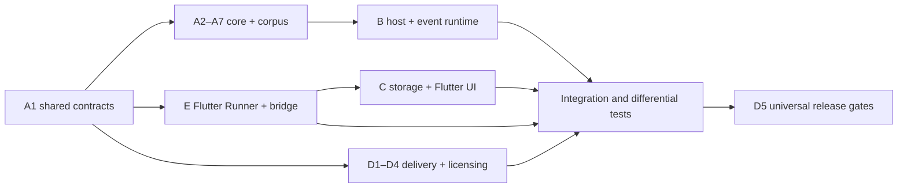

# Necaramba — сводный план реализации

> **For agentic workers:** REQUIRED SUB-SKILL: Use superpowers:subagent-driven-development or superpowers:executing-plans. Реализовывать задачи с RED/GREEN проверками и отдельным review каждого этапа.

Дата: 2026-10-14. Статус: **проект для согласования; реализация продукта не начата**. Исследовательские скрипты и псевдокод уже созданы, но не являются реализацией Necaramba.

**Goal:** Переключатель раскладки EN↔RU с подтверждённым набором функций, Flutter UI и Swift native core, macOS12+, Apple Silicon и Intel, с независимым языковым ядром и ресурсами.

**Architecture:** Pure Swift decision core; serial event runtime; AppKit status + Flutter settings; SQLite rules/counters; immutable verified rule snapshots; отдельные licensing/network adapters. Не переносить декомпилированный проект механически в новый продукт.

**Tech Stack:** Flutter/Dart + Cubit, platform channels, Swift tools5.9, language mode5, AppKit, Carbon/TIS, CoreGraphics, Accessibility, SQLite, CryptoKit, URLSession, XCTest; Xcode universal build. Совместимость каждого используемого API с macOS12 проверяется availability guards.

Основание: [спецификация](../specs/2026-10-14-necaramba-design.md).

## Global Constraints

- Flutter/Dart для UI, Swift/AppKit для нативного ядра; минимальная macOS 12.0; архитектуры arm64 и x86_64.
- Основной цикл ввода работает локально и без сети.
- Callback event tap не выполняет сеть, файловый ввод-вывод или блокирующие AX-вызовы.
- Не сохранять и не отправлять набранный текст по умолчанию.
- При неопределённом фокусе, Secure Input, IME/composition или недоступных разрешениях пропускать ввод без изменения.
- Синтетические события маркируются и не обрабатываются повторно.
- Код, идентификаторы сервисов, модели, звуки, графика и аккаунты сторонних переключателей не входят в распространяемый продукт.
- Не выпускать функцию как совместимую без соответствующего теста и результата в матрице приёмки.

## Порядок и файлы планов

| Этап | Задачи | Результат и зависимость |
|---|---:|---|
| [A — ядро и корпус](2026-10-14-necaramba-a-core.md) | 7 | Package, shared contracts, mapping, token buffer, classifier/policy/gesture FSM, независимый корпус; первый этап |
| [B — ввод и замена](2026-10-14-necaramba-b-input.md) | 6 | Native TestHost, permissions/TIS/context, ordered runtime, replacements/undo/clipboard, qualification; после A contracts |
| [C — Flutter-интерфейс, данные, lifecycle](2026-10-14-necaramba-c-ui-storage.md) | 6 | SQLite/migrations/import, prefs, меню/редакторы, appearance/sound/stats, permissions/login; после A и E bridge, интеграция с B |
| [D — доставка правил и выпуск](2026-10-14-necaramba-d-delivery.md) | 5 | Подпись/atomic install, sharing, own licensing, universal release gates; после A, интеграция B/C |
| [E — Flutter Runner и bridge](2026-10-14-necaramba-e-flutter-bridge.md) | 4 | SDK qualification, versioned channels, UI integration/lifecycle; после A1, E2 перед C UI |

Всего28 задач, разбитые внутри на проверяемые шаги с путями файлов, контрактами, тестами и командами. После утверждения A1 фиксирует shared public types; E1 квалифицирует SDK и Runner, E2 фиксирует bridge; затем части C/D допустимо вести параллельно B в отдельных worktrees. `Package.swift`, Xcode project и общие типы изменяет назначенный интегратор. Владение файлами указано в каждом плане; при конфликте сначала согласовать контракт, не создавать дублирующий тип.

## Покрытие функциональных требований

| Требования | Основные владельцы/задачи |
|---|---|
| F01–04 auto/layout/typo/double caps/ё | A2–A5/A7; B3–B4/B6; D1–D2 rules |
| F05–08 Shift/Option/SplitShift/undo | A6; B3–B4/B6; C preferences/UI |
| F09 plain paste | B5; C preferences |
| F10–11 word/app exceptions | A5; C1–C3; B policy/context integration |
| F12 rules update | D1–D2; B snapshot boundary; C freshness UI |
| F13 sound/F14 image/color/F15 statistics | C5 и соответствующие UI/storage шаги C |
| F16 menu/F17 permission onboarding/F19 help/F21 localization/accessibility | C UI + B capability; D release qualification |
| F18 launch at login | C lifecycle, separate12/13+ paths |
| F20 own trial/purchase/restore/subscription | D4; C paywall rendering |
| F22 explicit rule sharing | D3; C preview/consent |

В отдельных планах Task numbers являются локальными номерами, например C4=Task4 в C. AC-001–103 — oracle для реализации, а не результаты текущего исследования. Каждому результату приёмки добавить status PASS/FAIL/UNRUN/BLOCKED, commit, OS/build, architecture, host, ruleset hash и evidence path. Наличие test name без запуска не меняет UNRUN на PASS. D5 агрегирует **все** mandatory AC и4 Flutter gates E-01–E-04; отдельные coverage paragraphs помогают найти владельца, но не исключают требования из общего gate.

## Этапные gates

1. **G0 — согласование проекта.** Проверить спецификацию, deliberate differences, offline/licensing policy и внешний набор release inputs. До нового поручения реализацию не начинать.
2. **G1 — feasibility.** A1–A3, E1–E2 и B1–B2: на собственном TestHost подтвердить focus epochs, source switch/readback, capture/post permission и безопасный pass-through. При недоказанном поле backspace-auto не включается. macOS12 Intel — отдельный обязательный реальный host.
3. **G2 — детерминированное ядро.** A тесты и независимый corpus; не обучать/калибровать на holdout. Precision/false-change/recall из spec — release цели, не известные показатели других продуктов.
4. **G3 — ручные команды и транзакции.** B replacement/clipboard/own undo; ноль lost/duplicate/reordered user events в100000-event replay. Clipboard races, смена фокуса, Secure Input, sleep/lock покрываются отказными сценариями.
5. **G4 — полный функциональный UI.** C, все22F, persistent settings/import rollback, appearance image/sound, accessibility/RU/EN, login12/13+.
6. **G5 — automatic parity.** B6 differential corpus на original и candidate в контролируемом test profile; сравнить раннюю коррекцию, gestures/timing, selection/undo, app rules. Каждое расхождение классифицировать как defect, deliberate safety difference или unsupported; label не заменяет исправление mandatory feature.
7. **G6 — доставка и выпуск.** D tests: verified offline fallback, rollback/corruption, own licensing, подписанная universal сборка, clean install/TCC, производительность, все mandatory AC. Developer ID и MAS квалифицировать отдельно.

## Зафиксированные проектные решения

- Flutter UI выбран пользователем; Swift input/runtime/storage/delivery остаются native. Полный контракт bridge и lifecycle в плане E; все отображаемые настройки/rules имеют один native source of truth.
- RSS: исходная цель100MiB сохраняется для background без engine; для открытого Flutter UI предлагается200MiB, проверяется E4. Intel поддержка обязательна, pinned SDK и реальные host gates защищают от несовместимого upgrade.

- Независимые словари/правила вместо извлечённых сторонних моделей; собственные звук, графика, bundle IDs и endpoints.
- Консервативный abstain при неоднозначности; no-change на неподтверждённом фокусе/IME/Secure Input. Эти решения могут отличаться от агрессивности эталона и должны быть видны в сравнении.
- Тайминги300мс gesture и3×20мс layout retry — стартовые параметры дизайна; они не заимствованы из других продуктов.
- Clipboard restoration по changeCount; автоматическое восстановление не перезаписывает новое пользовательское копирование.
- UI word rules1–20 graphemes; отдельное сохранение legacy21–100. Unicode counting отличается от regex length и требует сравнительных кейсов.
- C использует recovery journal для целостного импорта SQLite+preferences; это конкретизация spec all-or-nothing на двух хранилищах. Legacy rows имеют отдельную таблицу.
- D v1 принимает identity package без compression; предел80MiB для декодирования остаётся защитной границей будущего формата. Подписанный пакет обязан пройти размер/hash/schema/version/signature checks.
- Коммерческий adapter D задаёт72h offline grace как предлагаемую политику нового продукта, не политику другого продукта. Developer ID лицензирование и StoreKit имеют разные адаптеры. Без собственных идентификаторов/endpoint commercial release gate остаётся BLOCKED; локальную реализацию/тесты можно выполнять с fixtures.

## Доступ и решения, нужные к выпуску

Для старта реализации дополнительных сведений не требуется: рабочее имя Necaramba и локальные adapters уже определены. До production release нужны собственный bundle ID/Developer team/signing, название/бренд, поддержка/privacy URL, ключи подписи rules и контролируемый endpoint, решение о цене/trial/StoreKit product IDs, Intel/macOS12 и Apple Silicon hosts. Эти данные не заимствовать из других продуктов и не выдумывать.

Физические тесты ввода ещё не выполнены. Для полного соответствия выполнить протокол физического ввода в контролируемом профиле; это обязательный открытый исследовательский gate. Ни текущий план, ни успешная пакетная декомпиляция его не закрывают.

## Проверка исполнения и handoff

На каждом шаге: RED на поведенческом тесте → минимальная реализация → GREEN → review контракта/ownership → локальный commit. До объявления готовности выполнить команды плана и сохранить вывод. Тестовые corpus и UI-host fixtures содержат только созданный для проверки текст. Декомпилированный код и чужие resources не подключать к build target.

После утверждения этого проекта реализацию начинать с A1, SDK feasibility E1 и native feasibility B1; не начинать с косметического UI, поскольку нерешённая безопасная доставка клавиш определяет архитектуру. При невыполнимом gate обновить spec с доказательством и вынести конкретное изменение объёма на согласование, не объявлять partial build полным аналогом.
