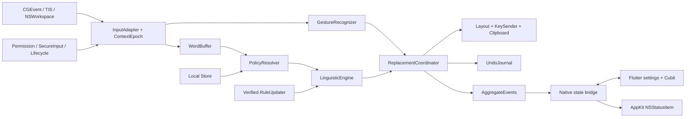

# Necaramba — спецификация функционального аналога Caramba Switcher Pro для macOS

Дата: 2026-10-14. Редакция Flutter по уточнению пользователя. Статус: проект для согласования; реализация не начата. Основание: запрос пользователя и исследование установленной Caramba Switcher Pro 2026.09.22 (20260922.2). Целевые функции — функции данной macOS-сборки, а не объединение всех исторических обещаний Windows и macOS.

## 1. Цель и граница соответствия

Создать независимую утилиту строки меню, которая исправляет ошибочную RU/EN-раскладку, типовые опечатки и регистр, расставляет ё, предоставляет ручное исправление слова/выделения, управляемые исключения и все подтверждённые вспомогательные функции эталона. Имя Necaramba — рабочее имя проекта по названию каталога, не утверждённый бренд.

Функциональное соответствие разделено на четыре проверяемых уровня:

1. **Каталог функций:** каждый подтверждённый сценарий представлен в продукте и тестах.
2. **Контракт поведения:** жесты, приоритеты правил, безопасная замена, отмена, состояние UI.
3. **Качество языка:** результаты на замороженном корпусе, сравнение с эталоном. Наличие тех же переключателей не считается равенством качества.
4. **Совместимость:** отдельно проверенные редакторы, раскладки, версии ОС и архитектуры.

Декомпиляция не возвращает исходный Swift/Rust проект. Exact parity всех неизвестных слов, серверных решений, таймингов и недоступных runtime-сценариев пока не доказана. Такие вопросы — условия допуска к релизу, а не повод объявлять неполный аналог готовым.

### Глобальные ограничения

- Flutter/Dart для UI, Swift/AppKit для нативного ядра; минимальная macOS 12.0; архитектуры arm64 и x86_64.
- Основной цикл ввода работает локально и без сети.
- Callback event tap не выполняет сеть, файловый ввод-вывод или блокирующие AX-вызовы.
- Не сохранять и не отправлять набранный текст по умолчанию.
- При неопределённом фокусе, Secure Input, IME/composition или недоступных разрешениях пропускать ввод без изменения.
- Синтетические события маркируются и не обрабатываются повторно.
- Исходный Caramba app, его идентификаторы сервисов, модель CLM1, звук, графика и аккаунт не входят в распространяемый продукт.
- Не выпускать функцию как совместимую без соответствующего теста и результата в матрице приёмки.

## 2. Основания требований

Исследование: [индекс](../../research/caramba/README.md), [ресурсы](../../research/caramba/resources-report.md), [живой UI](../../research/caramba/runtime-report.md), [платформенные источники](../../research/caramba/platform-and-product.md), [матрица приёмки](../../research/caramba/acceptance-matrix.md). Все следующие точные лимиты/пороги — **проектные решения**, если явно не названы наблюдениями.

| ID | Требование | Источник и критерий |
|---|---|---|
| F01 | Автопереключение ошибочного слова RU↔EN | UI, ресурсы; `ghbdtn`→`привет` при подходящем контексте; не транслитерация |
| F02 | Автоисправление распространённых опечаток | UI; отдельное включение; точные пары в собственном versioned ruleset |
| F03 | Две начальные заглавные | vendor-claim + событие `caramba_double_caps`; `ПРивет`→`Привет`, `HTTP` сохраняется |
| F04 | Ёфикатор | UI; `елка`→`ёлка`; неоднозначное `все` сохраняется без достаточного контекста |
| F05 | Single Shift меняет раскладку | UI; только одиночное нажатие без сочетания; обычный Shift+A не поглощается |
| F06 | Double Shift меняет слово/выделение и отменяет свою последнюю замену | UI + vendor-claim об отмене; приоритеты определены ниже и требуют сравнения с эталоном |
| F07 | Option как альтернативная ручная команда | UI, checkbox; отдельный opt-in; Option+клавиша остаётся сочетанием |
| F08 | Left+Right Shift переключает автоматический режим | UI, checkbox; feedback в меню и коротком overlay |
| F09 | Cmd+Shift+V вставляет plain text | UI; настройка отключения; сохраняет clipboard по контракту раздела 6 |
| F10 | Исключения для слов | UI/Core Data; добавить, удалить, очистить с подтверждением; локально по умолчанию |
| F11 | Правила для приложений: включить/выключить автоматику | UI/ресурсы; идентификация bundle ID; выбор .app; ручные команды отдельно от auto |
| F12 | Фоновые и ручные обновления правил, статус свежести | Ресурсы; независимый подписанный формат; отказ сети не ломает локальный режим |
| F13 | Звук, пользовательский звук, сброс | UI/ресурсы; decode при импорте; event tap не играет звук синхронно |
| F14 | Оформление шапки и сброс | Палитра ресурсов, параметр header color; собственные 25 цветов; drag-and-drop картинки, сохранение и удаление подтверждены декомпиляцией UI framework |
| F15 | Счётчики действий и оценка сэкономленного времени | UI/strings; агрегаты без текста, формула и веса прозрачны пользователю |
| F16 | Статус меню: active/off/warning/error/update | Ресурсы; приоритет permission/Secure Input/license выше косметических уведомлений |
| F17 | Onboarding разрешений и диагностика Secure Input | UI/ресурсы; listen/post/AX trust показываются раздельно |
| F18 | Запуск при входе | nib/helper; macOS12 helper, macOS13+ SMAppService; отражать отказ пользователя |
| F19 | О программе, версия, справка, поддержка, диагностика | UI; собственные URL; экспорт redacted diagnostics только явно |
| F20 | Trial/покупка/восстановление/подписка | UI; отдельный LicensingAdapter; только свои StoreKit продукты, см. раздел 10 |
| F21 | RU/EN интерфейс и доступность | Ресурсы; keyboard navigation, VoiceOver, contrast, Reduce Motion |
| F22 | Опциональная отправка пользовательского правила | Ресурсы; отдельное согласие на конкретное слово, preview payload, сеть только по действию |

Не включать как функции Switcher рекламу Timer/Time and Day/Clear, стандартные AppKit пункты Speech/Dictation/Transformations и старое автоматическое обучение исключениям. Автообучение удалено в changelog 2026.09.20; сохранённые импортированные исключения при этом не терять.

## 3. Архитектурное решение

По уточнению пользователя выбран **Flutter/Dart для интерфейса и Swift/AppKit для нативного ядра**. Flutter отображает настройки, onboarding, исключения, статистику, диагностику и paywall. Swift сохраняет linguistic core, event tap, TIS/UCKeyTranslate, replacement/undo, clipboard, SQLite, login item, permissions, sound, rules delivery и StoreKit. NSStatusItem/NSMenu и окно-хост остаются AppKit; содержимое окна — Flutter. Рассмотренные альтернативы: полностью AppKit снижает runtime footprint, но не соответствует выбранному UI-стеку; перенос обработки каждой клавиши в Dart добавляет асинхронную границу в критический путь. Выбранный вариант отделяет UI от обработки ввода.

Приложение — Flutter macOS Runner, подключающий локальные Swift package products NecarambaCore/NecarambaMac. Один native composition root владеет сервисами до завершения процесса. Закрытие окна и пересоздание Flutter engine не останавливают переключатель. Engine создаётся при открытии окна; при закрытии отменяются subscriptions, engine освобождается после проверки lifecycle в E4. Если корректное освобождение не подтверждено, сохранённый engine допускается только после измерения и пересогласования бюджетов памяти.

Flutter SDK фиксируется по версии и commit после qualification в E1, а не обновляется автоматически. На дату проверки официальная [матрица платформ Flutter](https://docs.flutter.dev/reference/supported-platforms) указывает macOS12+ и обе архитектуры, одновременно предупреждая о поэтапном прекращении Intel. Требование Intel сохраняется: каждый SDK upgrade проходит реальные Intel/macOS12 build/run gates. [Platform channels](https://docs.flutter.dev/platform-integration/platform-channels) используются для команд UI и снимков состояния, без потока keystrokes.

### Модули и владение состоянием

| Модуль | Ответственность | Не должен делать |
|---|---|---|
| CoreTypes | LayoutID, InputEvent, ContextToken, Rule, Decision, EditPlan | AppKit/сеть |
| InputRuntime | Выделенный CFRunLoop для tap; bounded очередь; epoch | Изменять UI или ждать IO |
| GestureRecognizer | Pure finite state machine Shift/Option | Отправлять события самостоятельно |
| Linguistics | Преобразование раскладки, словарь, классификатор, опечатки/ё/case | Читать pasteboard и активное приложение |
| PolicyResolver | Глобальные флаги, app rules, word rules, capability | Менять settings из callback |
| ReplacementCoordinator | Один последовательный владелец edit transaction | Делать optimistic backspace без валидного контекста |
| MacAdapters | TIS, CGEvent, pasteboard, workspace, permissions, sound | Содержать языковые правила |
| Persistence | SQLite transactions/schema migration + preferences | Хранить историю набранного текста |
| RuleUpdates | Проверка подписи/hash/version/schema, atomic swap, rollback | Исполнять код из rule package |
| Flutter UI | Dart widgets, Cubit, settings, exceptions, diagnostics | Владеть keyboard state/SQLite/license truth |
| Native shell + bridge | NSStatusItem, window/engine lifecycle, versioned commands/state | Посылать keystrokes/token/clipboard в Dart |
| Licensing | Только entitlement/status, собственный StoreKit | Вмешиваться в незавершённую edit transaction |

Flutter UI — Dart main isolate, Cubit для локального состояния представления; Swift shell/каналы — main thread. MethodChannel `necaramba/control.v1`, EventChannel `necaramba/state.v1`; полные snapshots с sessionID/revision, runtime truth принадлежит Swift. DTO и обработка ошибок определены в плане E. Между UI и native проходят только настройки, явно введённые пользователем исключения и агрегаты. Набранные в других программах слова, raw events и clipboard не передаются. EventRuntime — отдельный serial run loop. Input state изменяется только на runtime executor; UI публикует новый immutable PreferencesSnapshot командой. RuleUpdater строит новый RuleSnapshot в background, замена происходит между транзакциями. Для сетевых/store операций использовать Swift concurrency; не создавать Task на каждую клавишу без порядка и backpressure.

## 4. Входной контракт и распознавание жестов

Нормализованный InputEvent содержит монотонный timestamp, physical keycode, тип down/up/flagsChanged, modifier flags, текущий layout ID, origin (physical/ours/foreignSynthetic/unknown), ContextToken(pid, bundleID, focusEpoch, layoutEpoch), repeat и доступный Unicode. Нельзя считать event flag `sourceUnixProcessID` полной аутентификацией происхождения; собственный nonce-tag нужен для предотвращения цикла, не как security boundary.

Поддержанные источники v1: US/ABC, Russian, Russian-PC на ANSI/ISO/JIS с явными mapping fixtures. Состав enabled sources читается через TIS; идентификация по ID, не локализованному имени. Если одна сторона пары отсутствует, автоматическое переключение недоступно с пояснением; не добавлять раскладки самовольно. Caps Lock/Shift/пунктуация учитываются. Любое изменение layout вне нашей транзакции инвалидирует pending buffer.

### Gesture FSM — проектный контракт

- Один Shift: release без другой клавиши и без второго Shift; отложенное решение на 300 мс, чтобы отличить Double Shift. Это выбранный UX-компромисс, не измеренный тайминг Caramba.
- Double Shift: две отдельные пары down/up одного либо разных Shift за 300 мс, если не было chord; отменяет pending Single Shift и выдаёт одну manual action.
- Split Shift: одновременное удержание обеих физических Shift при включённой опции; одна команда на переход; не выдаёт single/double после отпускания.
- Option: release без другой клавиши, опция включена; не перехватывать Option+символ, Ctrl/Command chord, key repeat.
- Выделение имеет приоритет над текущим словом, если получено надёжным selection adapter. Без выделения: валидный UndoJournal для собственной последней правки → undo; иначе последний буфер слова → convert.
- После любой другой клавиши, mouse click, focus/layout epoch change и Secure Input сбросить pending gesture. Modifier replay сохраняет настоящий текущий набор modifiers.

300 мс — регулируемый параметр internal configuration, первоначально без отдельного UI. Изменять его по результатам UX/эталонных тестов, не замораживать как восстановленный constant.

## 5. Языковое ядро

### Представление

Буфер до 128 grapheme clusters и до 512 UTF-16 code units; превышение означает pass-through и сброс до следующего разделителя. Сохранять последовательность физических клавиш, modifiers и раскладку, а не только итоговый String. Курсор/selection, paste, navigation, mouse, горячие клавиши и неизвестное редактирование разрывают доверие к буферу. Backspace обновляет буфер только при подтверждённой семантике редактора; иначе сброс.

MVP распознаёт на границе слова Space/Return/Tab/пунктуация. Режим раннего исправления внутри слова — отдельный этап F01, допускается только после parity corpus и транзакционных тестов; отсутствие этого режима до завершения этапа — ограничение, а не полная совместимость.

### Pipeline

1. Проверить permissions, secure/composition state, ContextToken, app policy и включение функции.
2. Нормализовать текст для lookup (Unicode NFC + case-fold для lookup), сохраняя оригинал и case shape для результата.
3. Применить пользовательское исключение к исходному и потенциально исправленному слову; точное слово, не произвольный исполняемый regex пользователя.
4. Построить кандидат из физических клавиш в целевой раскладке. Это keyboard mapping, не фонетическая транслитерация.
5. Оценить исходный и целевой варианты: known-word lexicon, frequency bands, character n-grams, допустимые границы, явные never-switch tokens. При недостаточной разнице оценок abstain.
6. Сохранить аббревиатуры, all-caps known tokens, URL/email/path/code/номер, смешанные токены и неоднозначные короткие слова. Нельзя объявлять всякое неизвестное слово ошибкой.
7. На выбранном языке применить один детерминированный высокоуверенный typo-rule, затем double-capital correction, затем unambiguous ё-rule; итоговая замена — одна транзакция, не серия редактирований.
8. Вернуть Decision(pass, replace, manualOnly) с reasonCode, modelVersion и confidence band. Diagnostics не содержит текста без явного локального debug opt-in.

Rules v1 содержат lexicon (word/language/frequency/casePolicy), keyboard maps, typo replacements (source/target/caseSensitive), yo replacements (source/target/ambiguity), never-switch tokens, app capability profiles и versioned score parameters. Порог выбирается по holdout-корпусу; в спецификации намеренно не назначается выдуманный «порог Caramba». До принятия измеренного порога shipped auto остаётся выключенным.

### Качество

Создать не менее 10 000 синтетических/лицензированно полученных размеченных примеров, стратифицированных по языку, раскладке, регистру, mixed tokens, пунктуации и категориям приложений. Разделение train/calibration/holdout без утечки одинаковых семейств слов. В release holdout не менее 2 000 примеров, из них не менее 1 000 корректных no-change. Требования первого полноценного релиза: precision автоматических правок >= 99,5%, false-change <= 0,1% на no-change, recall ошибочной раскладки >= 95% на поддержанном подмножестве; публиковать размеры/число ошибок и интервалы неопределённости. Это цели, не достигнутые измерения.

Отдельный differential corpus сравнивает разрешённые эталонные сценарии Caramba и Necaramba. Любое расхождение triage: intentional safer behavior / missing feature / linguistic difference / environment. Стопроцентное тождество на конечном корпусе не означает тождество на любом тексте.

## 6. Замена, выделение, plain paste и отмена

EditPlan содержит исходный ContextToken, source/target layouts, original/replacement, подтверждённую область/physical suffix, trigger delimiter и planID. Подготовка не меняет чужой текст.

### Протокол транзакции

`idle → prepared → revalidated → applying → verifying → committed` либо `aborted`/`uncertain`. Перед первым удалением повторно проверить PID, focus/layout epochs, secure state, capabilities и suffix evidence. Смена active app, mouse/navigation/unknown input инвалидирует операцию. Один active edit; последующие физические события не теряются и не переставляются. Нельзя безгранично удерживать клавиши в ожидании сети/AX.

Предпочтительно адресовать события подтверждённому PID, но PID не идентифицирует поле: in-app focus detection — обязательный capability gate. При невозможности подтвердить поле автоматические backspace-правки отключены; ручные команды работают только в профилях с проверенной семантикой. Это потенциальное отличие от более агрессивного эталона, зафиксированное как безопасное проектное решение.

Поддерживаемые replacement adapters:

- **Key event adapter:** подтверждённый keyboard buffer, TIS select + readback, keycode/retype, сохранение delimiter; bounded layout retries 3×20 мс как начальные проектные значения. Не использовать задержку как доказательство успешности.
- **Selection clipboard adapter:** только явная manual action; snapshot всех materializable pasteboard items/types, Copy в целевой контекст, ожидание собственного changeCount, transform, Paste, readback где доступен, conditional restoration. Если выделения нет/Copy не дал новое значение — ничего не вставлять из старого clipboard.
- **AX adapter:** optional для проверенных controls, settable range/value с ошибками unsupported/cannotComplete; не выполняется в event callback. Не считать AX обязательным для MAS профиля.

Если после частичного применения результат не подтверждён, не выполнять слепой rollback по старому числу Backspace. Перейти в uncertain, остановить auto для контекста, показать ненавязчивое сообщение и сохранить только redacted diagnostic. Собственный UndoJournal хранится только в памяти, максимум одна последняя правка до следующего изменяющего контекст действия; не подменяется глобальным Cmd+Z.

Plain paste не переиспользует clipboard-history. При отсутствии строки hotkey передать приложению или показать no-text feedback без очистки clipboard. Snapshot restore допускается только при совпадении ожидаемого changeCount; новое копирование пользователя сохраняется. Для обещанных/lazy representations, неизвестного item или отказа доступа — отказ от операции до перезаписи clipboard. Upper bounds: 1 MiB plain text для ручной вставки/конвертации; 16 MiB суммарный materialized snapshot, иначе отклонить с пояснением. Эти лимиты — проектные.

## 7. Политики, настройки и данные

Приоритет: Secure Input/permissions/unsupported context → явное пользовательское правило приложения → shipped app profile → global auto flag → user word exclusion → classifier. Явный app allow не обходит Secure Input и capability gates. Ручные команды не зависят от global auto flag, но зависят от разрешений и безопасного контекста. Rule для слова подавляет auto/typo/ё; manual convert по явной команде разрешён. Семантику уточнять сравнением с эталоном, текущее значение — дизайн.

SQLite через системный libsqlite3, serial writer, WAL, foreign_keys=ON, schema_version в migration table. Файлы в Application Support собственного bundle ID; никакого чтения чужого Caramba store при обычной работе. Tables:

- `word_rules(id TEXT PK, normalized TEXT UNIQUE NOT NULL, original TEXT NOT NULL, created_at INTEGER NOT NULL, share_opt_in INTEGER NOT NULL DEFAULT 0)`.
- `legacy_word_rules(id TEXT PK, normalized TEXT UNIQUE NOT NULL, original TEXT NOT NULL, created_at INTEGER NOT NULL)` для валидных импортированных21–100 graphemes.
- `app_rules(bundle_id TEXT PK, display_name TEXT NOT NULL, bookmark BLOB NULL, mode TEXT CHECK(mode IN ('allow','deny')) NOT NULL, updated_at INTEGER NOT NULL)`.
- `daily_counters(day TEXT, kind TEXT, count INTEGER CHECK(count>=0), PRIMARY KEY(day,kind))`.
- `model_state(slot TEXT PRIMARY KEY, version INTEGER NOT NULL, digest TEXT NOT NULL, installed_at INTEGER NOT NULL)`.
- `migrations(version INTEGER PRIMARY KEY, applied_at INTEGER NOT NULL)`.

Настройки без текста — UserDefaults собственного домена: auto/typo/yo/singleShift/option/splitShift/plainPaste/sound, selected color, login preference, diagnostics opt-in. Sounds копировать в managed Application Support после чтения разрешённого пользователем файла и успешного декодирования; maximum 5 MiB/10 sec. Файлы/картинки не помещать в defaults.

Word-rule validation: NFC, trim; 1–20 grapheme clusters, запрет NUL/control characters, `=` и `%`, запрет токенов без букв, содержащих цифры; нормализованная уникальность. В оригинале найден regex с лимитом 20, тогда как Core Data допускает до 100; UI-лимит нового продукта — 20, legacy import до 100 хранится отдельно и не обрезается молча. Различие regex length и grapheme count проверяется differential Unicode cases. Импорт/export собственный JSON v1, transaction all-or-nothing для rules; combined rules+preferences использует recovery journal по плану C, без SQL из файла; копию БД перед migration, integrity_check и восстановление при ошибке. Старые скрытые Caramba entities не переносить без отдельного явно предоставленного экспорта.

## 8. Обновление правил и офлайн-режим

В app входит собственный базовый ruleset. Startup сначала загружает verified installed rules, иначе bundled rules. Никаких запросов к CDN Caramba. Собственный rule package: manifest JSON `schemaVersion, modelVersion, minimumAppVersion, payloadSize, payloadSHA256, keyID`; payload canonical binary/JSON; Ed25519 signature над canonical manifest + digest. Public keys bundled; key rotation через cross-sign или app update. Signature/hash/version проверяются до parsing/loading.

Download по HTTPS, timeout 15 sec, max payload 20 MiB, decompressed max 80 MiB, cancellation; при launch и затем раз в 24 часа с jitter ±2 часа; ручной check с throttle 30 sec. Сеть вне input executor. Установка write temp → fsync → verify → atomic rename → new immutable snapshot; оставить last-known-good. Anti-rollback modelVersion, исключение только для внутреннего отзыва подписанным recovery manifest. Повреждение, неизвестный key/schema, несовместимая app version — сохранить старую модель, отразить статус.

Share rule — отдельный endpoint своего сервиса, JSON только выбранное слово, язык, версия модели и optional feedback. До отправки показать эти поля; не передавать имя активной программы, install ID, окружение или историю ввода по умолчанию. Backend реализация — отдельный workstream; приложение должно полноценно работать при его отсутствии.

## 9. Интерфейс, статистика и жизненный цикл

NSStatusItem с собственными иконками: active/off; overlay warning для permissions/Secure Input; update indicator ниже критических причин. Settings окно: функции, жесты, исключения, правила/обновления, звук/оформление, запуск при входе, диагностика, о программе, лицензия при наличии коммерческого канала. Exceptions — Flutter список/таблица, две вкладки; состояния пусто/ошибка/нет доступа; удалить всё только после подтверждения. Все switches должны иметь accessibility role checkbox/switch и bool value, в отличие от неудобства исследованного UI.

F14: обязательны палитра 25 цветов, reset, drag-and-drop картинки TIFF/FileURL, сохранение между запусками и удаление через контекстное меню. Эти операции подтверждены в UI framework (`0x2fc78`, `0x2f540`, `0x30200`); формат внутреннего хранения аналога независим. Отказ декодирования сохраняет предыдущую картинку; лимиты файла и декодированных пикселей задаются планом C как проектные ограничения. Статистика: count по типу committed action; исключить aborted/replayed/synthetic duplicates. Оценка времени = Σ count(kind) × собственный versioned weight(kind); UI явно пишет «оценка», веса доступны в справке. Нельзя показывать как точное измеренное время пользователя. Сброс счётчиков отдельным действием.

Onboarding не просит Full Disk Access/Screen Recording. Пермишены и `CGEventTapCreate` проверяются фактически. Secure Input: очистить buffer, pending/undo, показать состояние; не выключать чужую защиту. Sleep/wake, session lock/unlock, external layout, frontmost-app change — invalidation + реинициализация наблюдателей. Tap timeout: не более 3 автоматических re-enable за 60 sec; после лимита disabled и сообщение. Обработать revocation и уничтожение tap без busy loop.

LaunchAtLogin: macOS12 login helper; macOS13+ ServiceManagement API. Источник правды — системный status, предпочтение UI отдельно. Только один работающий экземпляр, не делать глобальный launch daemon/root helper. Обновление приложения через собственный подписанный канал Developer ID либо StoreKit/App Store для MAS профиля; не смешивать два механизма в одной сборке.

## 10. Лицензирование и распространение

Первый внутренний Developer ID prototype работает с `LocalEntitlementProvider(.active)`; это отдельный режим разработки, не обход лицензии Caramba. Коммерческая совместимость F20 означает собственные UI/status contracts: checking, trial(until), active(until, renews), grace(until), pending, expired, revoked, unavailable. Даты в UTC для логики, локализованный вывод. StoreKit transaction проверяется, restore по кнопке, cancellation не ошибка, pending не выдаёт paid entitlement. Offline cache только для последнего verified entitlement в ограниченном grace window, policy документируется до commercial release.

Не требовать создания платной подписки для проверки basic input. Решение о бизнес-модели пользователя ещё не получено; платёжные сценарии входят в план отдельного коммерческого этапа. Product IDs, own backend domain, Apple Team ID — релизные входные данные владельца, их нельзя выдумать или скопировать из эталона.

Базовый канал — universal Developer ID app, hardened runtime, notarization и stapling. MAS — отдельная feasibility gate на реальном sandboxed prototype; наблюдаемый sandbox=true у Caramba доказывает его сборку, а не разрешённость любого выбранного AX подхода аналога. Условия Apple и доступность API сверяются на момент релиза.

## 11. Приёмка и измерения

[AC matrix](../../research/caramba/acceptance-matrix.md) задаёт конкретные входы/ожидания; она является проектными тестами, не отчётом об их прохождении.

- Чистые unit tests: mapping, normalization, token bounds, gesture FSM, policy precedence, correction/undo plan, migrations и signed update rejection.
- Deterministic replay: timestamped physical event fixtures, fake clock/layout/focus/permissions, последовательность emitted events; 100 000 событий без потерянных/повторных пользовательских событий.
- Integration harness: отдельное подписанное приложение с NSTextView/NSSecureTextField и контролируемыми selection/focus; оно создаёт только синтетические test data.
- Host matrix: macOS12/13 и поддерживаемые актуальные версии на Intel и Apple Silicon; actual Intel runner обязателен, Rosetta не замена.
- Editor matrix: TextEdit, Safari HTML input/textarea/contenteditable, Chromium, Electron text field; Terminal/IDE initial auto-deny до отдельной квалификации. RDP/VM, IME и игры обозначены unsupported без тестов.
- Release gates: no input corruption в полном replay/host corpus; unsigned model никогда не активируется; secure/password content не попадает в логи; migration rollback проходит; universal slices/sign/notary проверены.
- Производительность — цели на указанном тестовом Mac: tap callback p99 <= 2 ms, classifier p99 <= 10 ms для 32-symbol token; idle CPU <= 0,5% за 5 минут; RSS <= 100 MiB в фоновом режиме без Flutter engine; при открытом Flutter UI первоначальная проектная цель <= 200 MiB (подлежит измерению в E4); не считать их фактом без telemetry. Если бюджет нарушен, shipped capability уменьшается или оптимизация завершается до релиза.

## 12. Декомпозиция и условия готовности

Workstreams: A — pure core/corpus; B — системный input/replacement; C — storage/UI/lifecycle; D — model delivery/licensing/release. Каждый имеет отдельный план, integration contracts и собственные проверки. Зависимости: A до B, A+B до полного C; D может начать manifest tooling после A, но релиз только после C и всех gates.

Спецификация считается согласованной после проверки пользователем каталога функций и design differences. Реализация по этому документу требует отдельного запуска работ. Для утверждения «полный аналог» должны быть закрыты F01–F22, не осталось mandatory failed/unrun AC, опубликован differential report и явно указан поддержанный compatibility envelope. Состояние настоящего исследования не означает, что эти условия уже выполнены.
